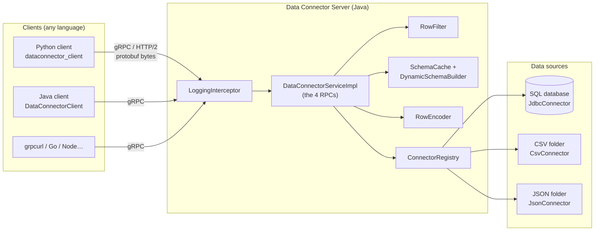
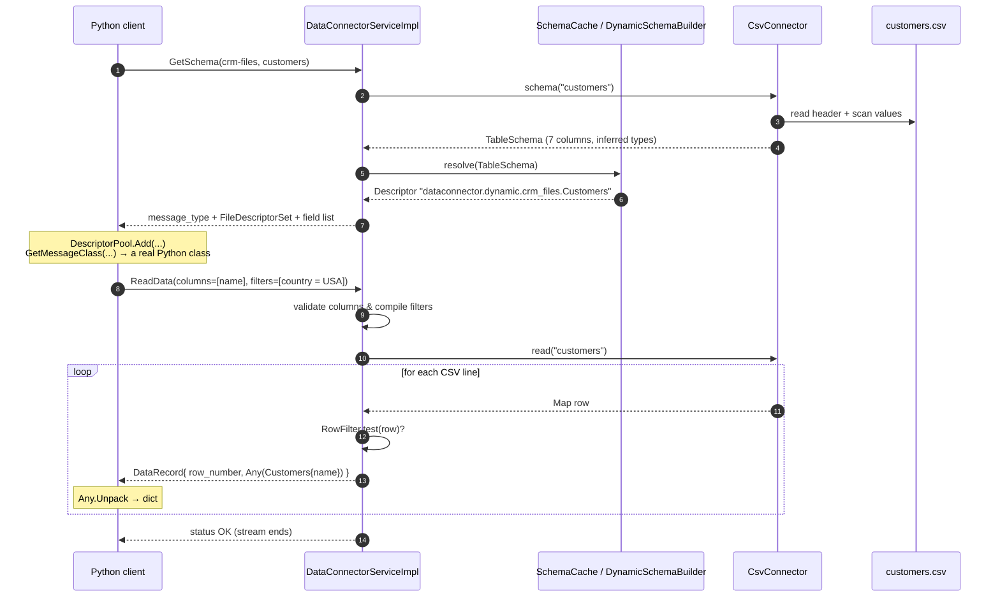
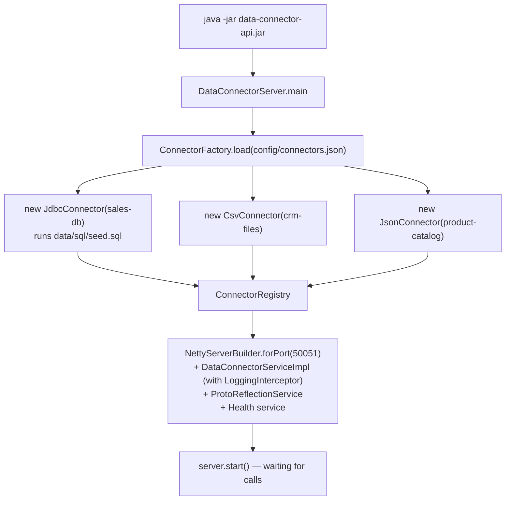

# 3. Architecture

## 3.1 The layers



Think of it as four layers, each only talking to its neighbour:

| Layer | Job | Classes |
|-------|-----|---------|
| **Transport** | Networking, HTTP/2, encoding bytes | gRPC library (Netty) + generated code |
| **API** | Validate requests, call the right connector, translate errors | `DataConnectorServiceImpl`, `LoggingInterceptor`, `RowFilter` |
| **Schema** | Turn "a list of columns" into a real Protobuf type and rows into messages | `DynamicSchemaBuilder`, `RowEncoder`, `SchemaCache` |
| **Connectors** | Know how to talk to one kind of source | `DataConnector` + `CsvConnector`, `JsonConnector`, `JdbcConnector` |

The most important design rule: **the API layer never knows what kind of source it is talking to.**
It only uses the `DataConnector` interface. That's what lets you add a new source without touching
the API, the `.proto`, or any client.

## 3.2 The common language inside the server: `TableSchema` and `Map` rows

Every connector speaks its own native dialect:

- CSV: a header line and text cells — no types at all.
- SQL: `DatabaseMetaData` with `java.sql.Types` like `DECIMAL(10,2)` and `VARCHAR(50)`.
- JSON: objects whose values are strings, numbers, booleans, arrays…

Each connector translates its dialect into two simple shapes:

```java
record Column(String name, ColumnType type, boolean nullable) {}
record TableSchema(String connectorId, String dataset, List<Column> columns) {}

Stream<Map<String, Object>> read(String dataset);   // values: String, Long, Double, Boolean or null
```

Only four column types exist on the API (`STRING`, `INT64`, `DOUBLE`, `BOOL`). Fancier SQL types
(`DATE`, `TIMESTAMP`, `DECIMAL`) are mapped to the closest one. This "lowest common denominator" is a
deliberate trade-off: every language understands these four perfectly.

## 3.3 Life of a request: `ReadData`

Let's follow a Python program asking for *US customers, names only*:

```python
client.read("crm-files", "customers", columns=["name"], where=["country=USA"])
```



Step by step:

1. **GetSchema.** The client first needs to know how to decode rows. The server asks the connector
   for the `TableSchema`. For CSV, `CsvConnector` reads every line and **infers** each column's type.
2. **Build a descriptor.** `DynamicSchemaBuilder` turns the `TableSchema` into a Protobuf message type
   called `Customers` in package `dataconnector.dynamic.crm_files`. `SchemaCache` remembers it so the
   next request is instant.
3. **Ship the schema.** The response contains a `FileDescriptorSet` — the message type written *as
   protobuf data*.
4. **Client builds a class.** Python loads it into a `DescriptorPool` and calls
   `message_factory.GetMessageClass`, producing a class exactly like one `protoc` would have generated.
5. **ReadData.** The server validates the request (`name` exists? `country` exists? `USA` is valid for a
   string column?) and compiles the filters into a Java `Predicate`.
6. **Stream.** The connector yields rows one at a time. Each one is tested against the filter, encoded
   by `RowEncoder` into a `DynamicMessage` (only the `name` field is set because of the projection),
   wrapped in `google.protobuf.Any`, and sent immediately.
7. **Decode.** For each `DataRecord`, the client calls `Any.Unpack(msg)` with its runtime class, which
   also checks the `type_url` matches — so you can't accidentally decode an `Orders` row as `Customers`.
8. **Done.** After the last row, the server calls `onCompleted()`, and the client's loop ends.

## 3.4 Startup



## 3.5 Design decisions (and their trade-offs)

| Decision | Why | Trade-off |
|----------|-----|-----------|
| Rows as `google.protobuf.Any` + runtime descriptors | The `.proto` can stay fixed while datasets come and go | Clients make one extra call (`GetSchema`); no compile-time type checking of row fields |
| Every dynamic field is `optional` | Distinguish `0`/`""` from SQL `NULL` (`HasField`) | Slightly bigger descriptors |
| Only 4 column types | Every language maps them perfectly | Dates arrive as strings; decimals as doubles |
| Server-side filtering | Less data on the network, one implementation for all clients | Generic filter isn't as fast as SQL `WHERE` pushdown (a great extension exercise) |
| Server streaming for rows | Constant memory, early results, cancellable | Slightly more complex client loop |
| Schema cache keyed by dataset, compared by value | Fast, but still picks up changed CSV headers | Schema is re-derived from the source on each call (cheap for demo data) |
| One `DataConnector` interface | Open/closed principle: add sources without editing the API | Interface must stay generic |

## 3.6 What production systems add

- **Security:** TLS (`useTransportSecurity()`), authentication via an interceptor reading a token from
  `Metadata`, per-column access rules.
- **Pushdown:** translate filters and projections into SQL `WHERE`/`SELECT` so the database does the work.
- **Pagination / resume tokens** for very large reads.
- **Flow control:** respect `ServerCallStreamObserver.isReady()` so a slow client doesn't make the
  server buffer too much.
- **Observability:** metrics (OpenTelemetry), tracing, structured logs.
- **Schema versioning:** include a schema fingerprint so clients know when to refresh their cached class.

Next: [4. Dynamic schemas](04-dynamic-schemas.md)
